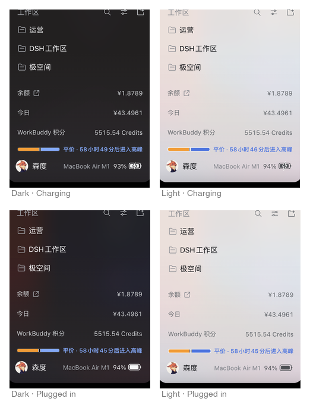

# dsh-battery-badge

**在 DeepSeek Harness 侧栏底部，显示这台终端的真实身份与供电状态。**

它读取 Harness 所安装机器的硬件信息，识别设备型号与品牌，并按设备类型给出最合适的呈现——笔记本看电量，其它设备看图标。



## 它能识别什么

| 设备类型 | 显示内容 | 品牌 / 型号 |
|---|---|---|
| **笔记本** | 机型 + **电量百分比** + **电池图标**<br>充电时电池显示充电效果，满电时显示插头 | MacBook Air / MacBook Pro、Windows 笔记本 |
| **iMac** | 机型 + iMac 图标 | 苹果一体机 |
| **Mac mini** | 机型 + Mac mini 图标 | 苹果迷你主机 |
| **Windows 台式机** | 机型 + 台式机图标 | 立式机箱造型 |
| **NAS** | 机型 + 品牌图标 | **极空间、绿联、飞牛、群晖** |

> 只有笔记本会显示电量百分比——台式机和 NAS 没有电池，不会出现「—%」这类无意义的占位。

## 电池显示细节

笔记本的电池图标按 macOS 菜单栏的观感绘制：

- **放电中** — 电池壳 + 随电量变化的填充，一眼看出还剩多少
- **充电中** — 叠加闪电符号，闪电上下探出电池壳，轮廓清晰
- **已充满 / 接电未充** — 显示插头符号

低电量时图标会转为警示色，提醒你插电。

## 外观与交互

- **排序**：机型名 → 电量百分比 → 图标，贴合侧栏那一行的阅读节奏
- **字体**：Apple 系统字体（`-apple-system` / SF Pro Text / PingFang SC），与 macOS 界面一致
- **主题**：浅色模式用深色线条、深色模式用白色线条，跟随界面自动切换
- **收起时隐藏**：侧栏折叠成 56px 图标栏时自动隐藏，避免遮挡头像
- **不挡点击**：徽标区域不拦截鼠标事件，账号菜单照常可用

## 安装

```sh
dsh plugin --profile <你的profile> add github:JhanSu/dsh-battery-badge
```

桌面端也可在 **设置 → 插件** 中通过插件管理器安装。装好后刷新页面即可。

## 数据来源与隐私

**完全本地运行：不联网、不上传、不写盘。**

| 平台 | 读取内容 |
|---|---|
| macOS | `pmset -g batt`（电量 / 充电状态 / 剩余时间）、`sysctl -n hw.model`（机型代号） |
| Linux | `/sys/class/power_supply/*`（电池）、`/sys/class/dmi/id/*`（厂商与型号）、`/etc/os-release` |
| Windows | `Win32_Battery`（电量）、`Win32_ComputerSystem`（型号） |

**不读取**：序列号、硬件 UUID、Provisioning UDID、账号信息、任何用户文件。

宿主路由 `/api/battery-badge/status` 仅监听回环地址，并要求有效的 DSH 登录会话（通过 `connection.requestRejection` 校验）——外部无法访问。

## 刷新机制

1. **浏览器 Battery API 事件（主路径）**：插拔电源、电量变化时立即响应
2. **20 秒兜底轮询**：用于不支持该 API 的浏览器，以及剩余时间的文字递减

宿主侧缓存 1 秒，并支持 `?fresh=1` 强制刷新。

## 许可证

MIT
